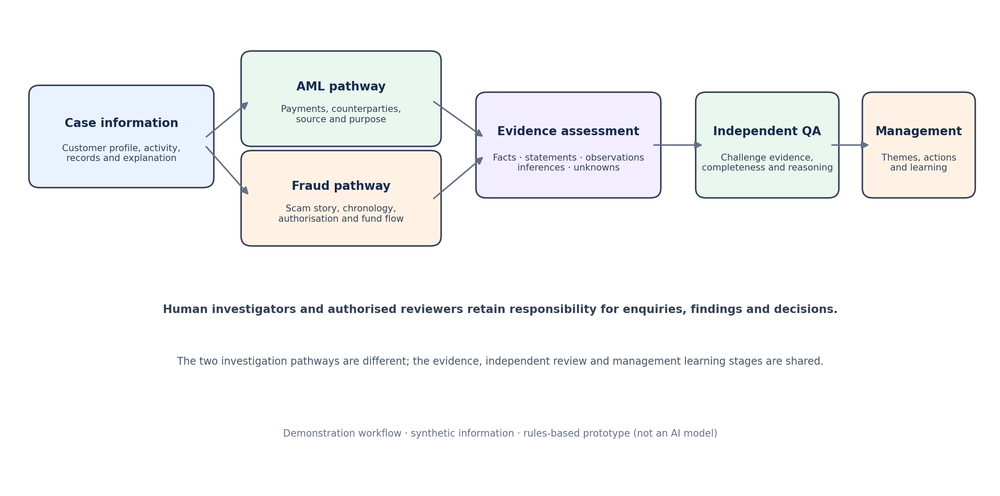

# Intelligent AML & Fraud Investigation and Quality Assurance

**A banking operations prototype for more consistent investigations, stronger evidence assessment and independent quality review.**

> **Project status:** Demonstration prototype. The current application uses transparent, predefined rules and synthetic cases. It is **not an AI model**, is not connected to a bank, and has not been validated for operational use.

## Why this matters

An investigation can contain many transactions, explanations and documents. The challenge is not simply finding unusual activity. Investigators must understand what happened, establish what the evidence supports, identify what is still unknown and explain why the case position is reasonable.

Quality reviewers need to challenge the investigation independently—not simply check whether a form has been completed. Managers also need to understand recurring weaknesses across cases.

This project demonstrates one connected workflow for those activities.

## What the demonstration covers

- **AML investigation:** examine incoming and outgoing payments, customer profile, counterparties, source and purpose of funds, and unanswered questions.
- **Fraud investigation:** examine the scam story, payment chronology, customer authorisation, beneficiary details, fund movement and recovery enquiries.
- **Evidence assessment:** separate recorded facts, customer statements, analyst observations, assumptions and unknowns.
- **Independent quality review:** identify incomplete or unsupported work and specify what needs to be corrected.
- **Management view:** show case-level quality themes from the supplied examples. The figures are illustrative, not performance statistics.

## How the workflow fits together



The AML and fraud investigations use different questions. They share the evidence assessment, independent review and management learning stages.

## Try the prototype

The application is a small local demonstration built with Python's standard library. It does not require paid software or third-party Python packages.

1. Download or clone this project folder.
2. Install Python 3.9 or later if it is not already installed.
3. Open a terminal in this project folder.
4. Run:

```bash
python prototype/app.py
```

5. Open `http://127.0.0.1:8000` in your browser.
6. Select the AML, fraud or incomplete-quality example and explore the analysis.

To stop the application, return to the terminal and press `Ctrl+C`.

**Note:** The local application is not hosted on GitHub Pages. GitHub displays this README and the supporting files; it does not run the Python application.

## What the prototype actually does

| Capability | Demonstrated behaviour |
|---|---|
| Case selection | Loads three supplied synthetic cases |
| Transaction review | Calculates incoming, outgoing and net transaction totals |
| AML prompts | Shows predefined questions about payment parties, source and purpose |
| Fraud prompts | Shows predefined questions about scam chronology, authorisation and fund movement |
| Evidence review | Displays known facts, customer statements and unresolved questions recorded in each case |
| Quality review | Applies a transparent checklist and flags missing or unsupported work |
| Management view | Summarises quality themes across the three sample cases |
| Export | Provides a downloadable JSON snapshot of the selected case analysis |

The application does **not** read bank documents, connect to banking systems, identify real people, make a suspicious activity decision, determine fraud liability or submit regulatory reports.

## Explore the supporting material

### Business and operating model

- [Solution design](solution-design.md) — purpose, users, process and boundaries.
- [Investigation pathways](investigation-pathways.md) — how the AML and fraud approaches differ.
- [Demonstration walkthrough](demonstration-walkthrough.md) — a short guided tour of the three cases.
- [Illustrative outputs](illustrative-outputs.md) — examples of what a useful investigator and reviewer output should say.

### Investigation and quality guidance

- [Evidence assessment guide](evidence-assessment-guide.md) — how to distinguish facts, explanations, observations and unknowns.
- [Independent quality checklist](independent-quality-checklist.md) — practical review questions for AML and fraud cases.
- [Management intelligence](management-intelligence.md) — how recurring quality issues can be grouped and used.
- [Limitations and controls](limitations-and-controls.md) — what this prototype can and cannot safely be used for.

### Prototype and sample data

- [Prototype instructions](prototype/README.md)
- [Application source code](prototype/app.py)
- [AML synthetic case](sample-data/aml-case.json)
- [Fraud synthetic case](sample-data/fraud-case.json)
- [Incomplete investigation for QA challenge](sample-data/quality-failure-case.json)

## How to interpret the examples

All names, accounts, institutions, dates, amounts and events are fictional. They are designed to support a demonstration, not to represent a real bank case or a typical rate of financial crime.

An unusual transaction pattern is a reason to ask questions—not proof of wrongdoing. A customer explanation is not automatically verified. A missing document is an evidence gap, not evidence of criminal conduct.

The case position must remain proportionate to the evidence available. A human investigator and authorised reviewer remain responsible for decisions.

## Business value being explored

The prototype is intended to make the investigation process more structured and reviewable. Potential benefits to explore in a properly designed and tested implementation include:

- More consistent recording of investigative reasoning.
- Earlier visibility of unanswered evidence questions.
- Clearer separation between investigation and independent review.
- More actionable quality feedback.
- Better visibility of recurring process and training needs.

No time savings, accuracy improvements or financial benefits have been measured or claimed.

## Development stage and next steps

**Current stage:** Rules-based demonstration prototype using synthetic data.

The next meaningful development step would be to test the workflow with experienced AML and fraud practitioners, refine the case questions and review criteria, and then assess whether an approved AI service adds value. Any such use would require privacy, security, model validation, records management and governance controls.

---

*This is an independent portfolio demonstration. It is not affiliated with or endorsed by any financial institution.*
