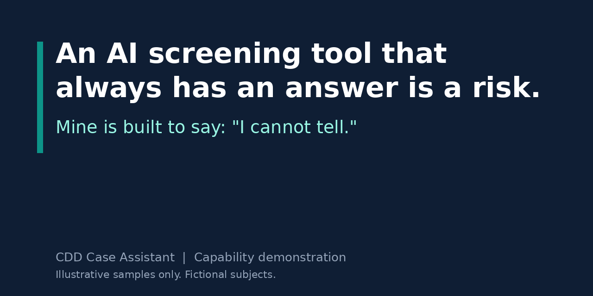
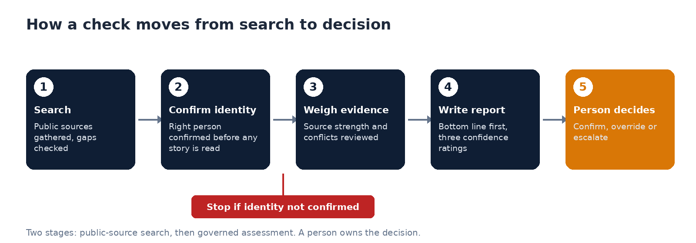
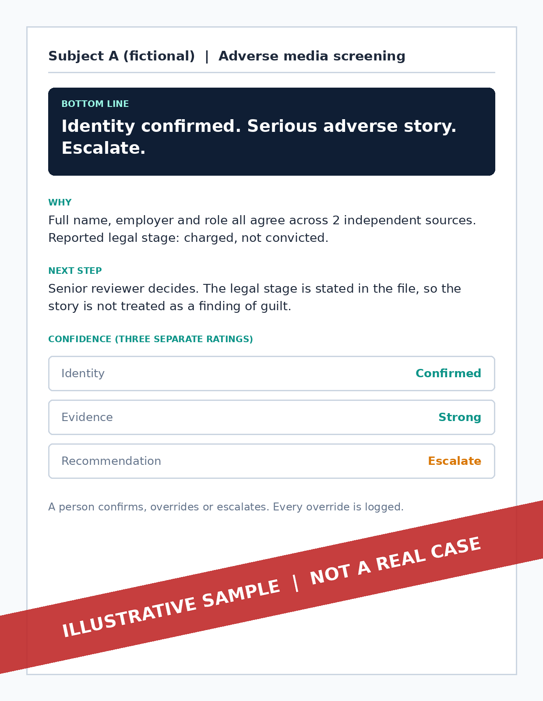
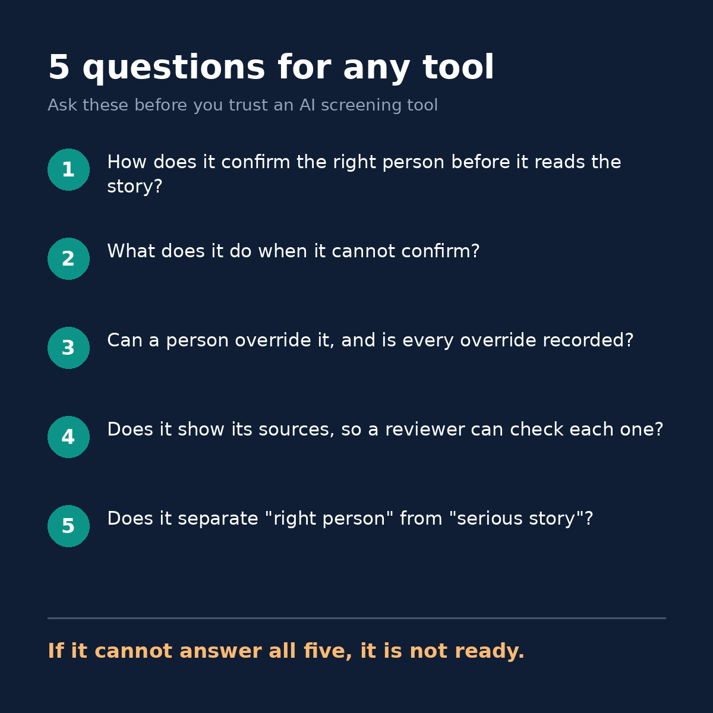

# An AI screening tool that always has an answer is a risk.

Mine is built to say: "I cannot tell."

Below: 3 worked examples, the 6 design decisions behind them, and 5 questions that test any screening tool.

*CDD Case Assistant | Capability demonstration, not a production system.*

## The problem

A name in a news story matches your customer's name. The story is about fraud.

Is it your customer, or someone with the same name?

Under time pressure, the easy move is to guess. A wrong clear leaves a risk in your book. A wrong flag treats an innocent customer as a suspect.

Either way, someone has to defend the decision.

## What I built

An AI-assisted way to check adverse media and company ownership. The AI prepares the judgement. A person owns it.

It works in two stages: a public-source search, then a governed assessment. A person then decides.

1. **Search.** Public sources are gathered and checked for gaps.
2. **Confirm identity.** The right person is confirmed before any story is read.
3. **Weigh the evidence.** Source strength and conflicts are reviewed.
4. **Write the report.** The bottom line comes first, with three separate confidence ratings.
5. **A person decides.** Confirm, override or escalate.

If identity cannot be confirmed, the process stops and the report says what is missing.

## 3 worked examples

**Illustrative samples.** I constructed these to show the layout and the types of outcome. They are not records of real cases, and every subject is fictional.

**Example 1: clear match, serious story**
> **Subject A (fictional) | Adverse media screening**
> **Bottom line:** Identity confirmed. Serious adverse story. Escalate.
> **Why:** Full name, employer and role all agree across 2 independent sources. Reported legal stage: charged, not convicted.
> **Confidence:** Identity confirmed. Evidence strong. Recommendation: escalate.
> **Next step:** Senior reviewer decides. The legal stage is stated in the file, so the story is not treated as a finding of guilt.

**Example 2: same name, wrong person**
> **Subject B (fictional) | Adverse media screening**
> **Bottom line:** Story not used. No adverse finding.
> **Why:** The name matches, but the employer, location and age range do not. The story is set aside, with the reason recorded.
> **Next step:** Reviewer confirms the set-aside, or requests more details.

**Example 3: not enough to say**
> **Subject C (fictional) | Adverse media screening**
> **Bottom line:** Insufficient evidence to reach a conclusion.
> **Why:** 1 source could be securely matched, and it is a corporate appointment notice that is not adverse. The other sources match on name only, so they were not used.
> **Confidence:** Identity not confirmed. Evidence insufficient. Recommendation not reached.
> **Next step:** Reviewer requests more identifying details from the case file. The check is then re-run.

I also ran one live test on a fictional subject. It returned insufficient evidence, for the reason in Example 3: only 1 source matched, and it was not adverse.

## What stops each risk

| What could go wrong | The control | Where |
|---|---|---|
| Gaps in the evidence collected | Completeness check on the search | Step 1 |
| Instructions hidden in a web page | The search stage defends against them | Step 1 |
| Wrong person matched | Identity confirmed before any story is weighed | Step 2 |
| Weak or unreliable source | Source strength reviewed | Step 3 |
| Sources disagree | Contradictions reconciled | Step 3 |
| False certainty | Three separate confidence ratings | Step 4 |
| Machine makes the decision | Hard stops and no automatic clear path | Step 5 |
| Reviewer habits go unseen | Every override is logged for later review | Step 5 |

## Decisions I made and rejected

| Decision | Why |
|---|---|
| No confidence percentages | A percentage looks precise. This kind of judgement is not. |
| No automatic clear path | If the tool can clear a case alone, a person no longer owns the decision. |
| Hard stops in a fixed order | A later step cannot rescue an identity that was never confirmed. |
| Bottom line first in every report | A busy reviewer sees the outcome before the detail. |
| Search and assessment kept separate | Gathering and judging are different jobs. Keeping them apart shows where an error entered. |
| Fictional subjects in demos | Private individuals are never used. |

## Why I rejected percentages

"87% confident" sounds like measurement. It is not.

It hides three different questions: is it the right person, is the evidence strong, and what should be done. A tool can be sure of one and unsure of the others.

So I split the rating into three, in plain words. A reviewer can see exactly where the doubt sits.

## 5 questions for any tool

1. How does it confirm the right person before it reads the story?
2. What does it do when it cannot confirm?
3. Can a person override it, and is every override recorded?
4. Does it show its sources, so a reviewer can check each one?
5. Does it separate "right person" from "serious story"?

If a tool cannot answer all five, it is not ready.

## Limits

- Fictional samples only. No results on real cases are shown or claimed.
- One live test on a fictional subject. It is not a measure of accuracy.
- No accuracy or adoption figures are claimed.
- It supports a human reviewer. It does not make decisions.
- Not formal model validation or independent assurance of an AI system.

## Work with me

The tool is proprietary. I help teams bring AI into high-stakes decisions while a person stays accountable. This page is for heads of financial crime and compliance in banks, fintechs and AML/CTF Tranche 2 entities.

- **Governance review** of an AI-assisted screening process.
- **Oversight design:** where a person must decide, and how escalation works.
- **Governed pilot:** a tool like this built for your own use case.

**Enquiries:** send me a message on LinkedIn. Say which offer interests you and what decision you are trying to make safer.

Name: Ketul Shah. LinkedIn: https://www.linkedin.com/in/ketulhshah/
