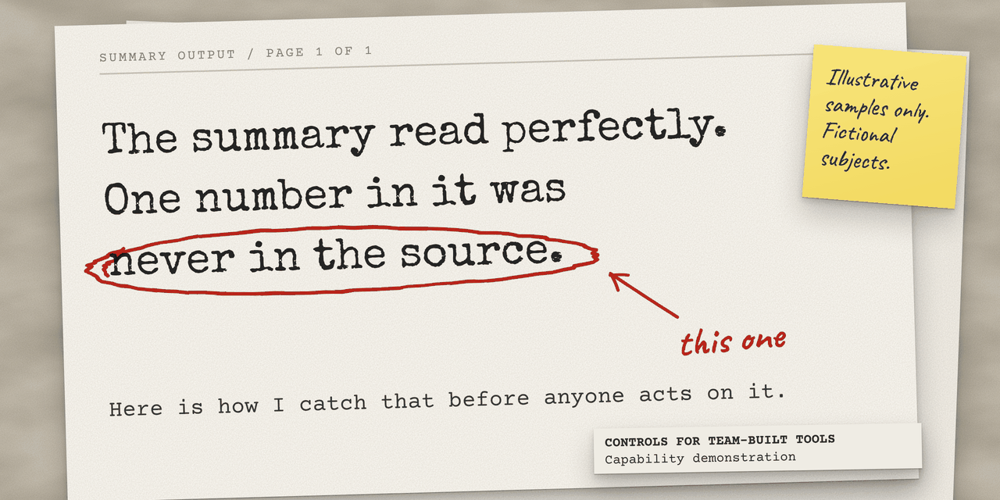
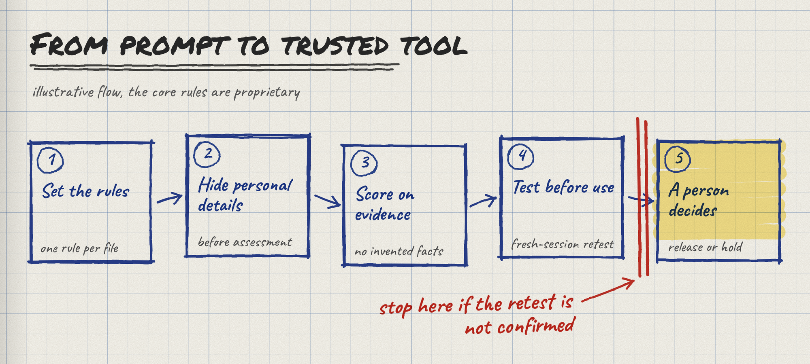
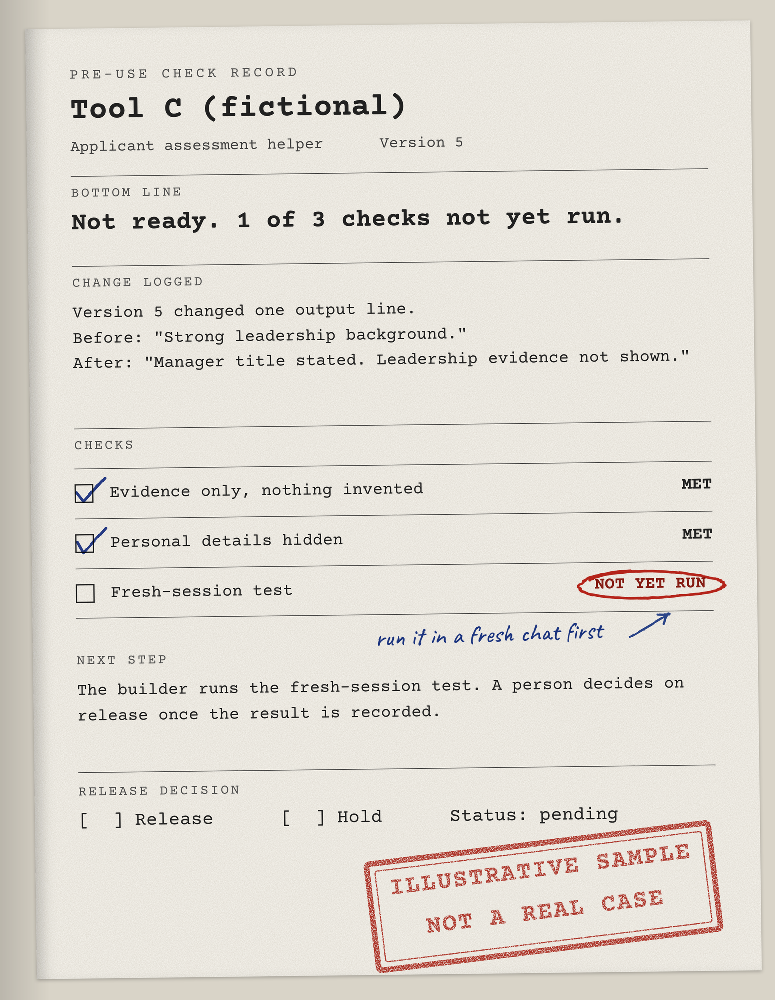
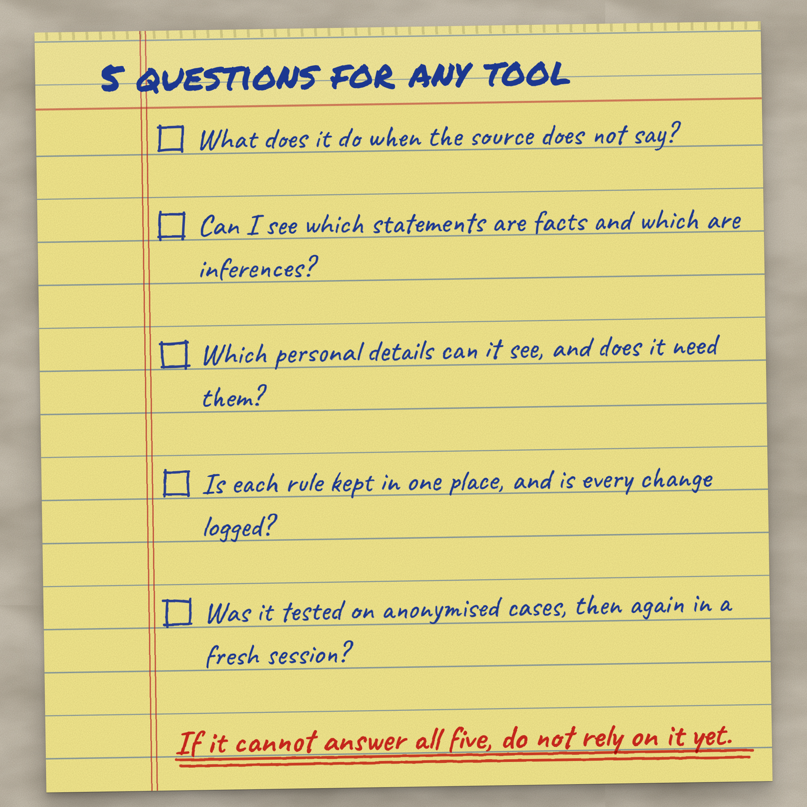

# The summary read perfectly. One number in it was never in the source.

Here is how I catch that before anyone acts on it.

Below: 3 worked examples, the controls behind them, and 5 questions that test any AI tool.

*Controls for Team-Built Tools | Capability demonstration, not a production system.*

## The problem

Tools built from prompts look finished from day one. The layout is tidy and the wording is sure of itself.

A wrong figure in a polished summary gives no warning. It surfaces when someone acts on it.

Anyone with a prompt can now build one of these. Once it feeds a decision, someone has to explain why it was trusted.

## What I built

A set of checks I put around tools built from prompts. I developed them while building tools as multi-file rule systems in Claude Projects, where each rule sits in its own file.

The checks run in 5 steps. A person decides at the end.

1. **Set the rules.** One rule per file. One source of truth for each.
2. **Hide personal details.** Name, gender, nationality and school never reach the assessment.
3. **Score on evidence.** Nothing is invented. A guess is labelled as a guess. Scoring is kept apart from presentation.
4. **Test before use.** Anonymised cases first, then the same cases again in a fresh session.
5. **A person decides.** Release or hold. Every change is logged with before and after wording.

If the fresh-session test does not confirm the first result, the tool is not released.

## 3 worked examples

**Illustrative samples.** I constructed these to show the checks at work. They are not records of real cases, and every subject is fictional.

**Example 1: nothing invented**

> **Applicant A (fictional) | Assessment output**
> **The CV says:** "Managed a team in operations."
> **The tool writes:** "Team size is not stated. Leadership scope cannot be scored beyond the job title."
> **Inference, labelled:** "Likely a supervisory role, based on the title. Not confirmed in the text."
> **Why it matters:** A reviewer sees what the source says, what the tool guessed, and the line between them. No team size appears, because the source has none.

**Example 2: personal details hidden**

> **Applicant B (fictional) | What the assessment receives**
> **Removed before assessment:** name, gender, nationality, school.
> **Kept:** roles, dates, duties and results the CV states.
> **Why it matters:** The assessment cannot weigh what it never receives.

**Example 3: not ready for use**

> **Tool C (fictional) | Pre-use check record, version 5**
> **Bottom line:** Not ready. 1 of 3 checks not yet run.
> **Change logged:** One output line reworded. Before: "Strong leadership background." After: "Manager title stated. Leadership evidence not shown."
> **Checks:** Evidence only: met. Personal details hidden: met. Fresh-session test: not yet run.
> **Next step:** The builder runs the fresh-session test. A person decides on release once the result is recorded.

One of my tools reached version 8. Every version has a log of what changed, with before and after wording.

## What stops each risk

| What could go wrong                             | The control                                                     | Where  |
| ----------------------------------------------- | --------------------------------------------------------------- | ------ |
| A fact appears that the source does not contain | Evidence-only scoring and a ban on invented facts               | Step 3 |
| A guess reads like a finding                    | Every inference is labelled as an inference                     | Step 3 |
| Personal details sway the result                | Name, gender, nationality and school hidden from the assessment | Step 2 |
| Two rule files say different things             | One rule per file, one source of truth                          | Step 1 |
| A better layout moves a score                   | Scoring kept separate from presentation                         | Step 3 |
| It works once and fails the next time           | Anonymised cases tested, then repeated in a fresh session       | Step 4 |
| A change breaks something unseen                | Version log with before and after wording                       | Step 5 |
| One AI tool's blind spot becomes the design     | Design cross-checked across several AI tools                    | Step 1 |

## Decisions I made and rejected

| Decision                             | Why                                                                               |
| ------------------------------------ | --------------------------------------------------------------------------------- |
| Evidence only, no invented facts     | A confident guess reads like a finding. A visible gap is safer than a filled one. |
| Inferences allowed, but labelled     | A reviewer needs the reasoning and must see where the source ends.                |
| Personal details hidden              | A tool cannot use what it never sees.                                             |
| One rule per file                    | A rule kept in two places drifts apart.                                           |
| Scoring apart from presentation      | A change to wording must never change a score.                                    |
| Every change logged                  | Without before and after wording, nobody can say why the output moved.            |
| Design cross-checked across AI tools | I accepted, changed or rejected each point myself.                                |
| Rejected: trusting one good test run | A result that appears once is not a result.                                       |

## The line to listen for

Ask a tool something its source cannot answer.

If it never says "the source does not say", it is guessing somewhere.

Fluent wording hides the guess, so my tools label each one. A person then sees where the evidence ends.

## 5 questions for any tool

1. What does it do when the source does not say?
2. Can I see which statements are facts and which are inferences?
3. Which personal details can it see, and does it need them?
4. Is each rule kept in one place, and is every change logged?
5. Was it tested on anonymised cases, then again in a fresh session?

If a tool cannot answer all five, do not rely on it yet.

## Limits

- Fictional samples only. No results on real cases are shown or claimed.
- No accuracy, improvement or adoption figures are claimed.
- Testing on anonymised cases shows a tool behaves as designed. It does not prove its output is right.
- Tools built from prompts can behave differently when the AI platform changes. That is why the fresh-session test exists.
- Rules, thresholds and datasets are not published. You cannot rebuild the tools from this page.
- Not formal model validation or independent assurance of an AI system.

## Work with me

The core tools are proprietary. I help teams that build their own AI tools put the right checks around them. This page is for heads of operations, risk, compliance and technology in banks, fintechs and professional firms.

- **Tool check:** I test a team-built tool against the 5 questions and the control map, and report the gaps.
- **Control set:** a short set of build rules for your teams, so each tool has checks from its first version.
- **Build workshop:** your team takes one business problem through requirements, documentation, build and testing, with the checks in place.

**Enquiries:** send me a message on LinkedIn. Say which offer interests you and what decision you are trying to make safer.

Name: Ketul Shah. LinkedIn: https://www.linkedin.com/in/ketulhshah/
