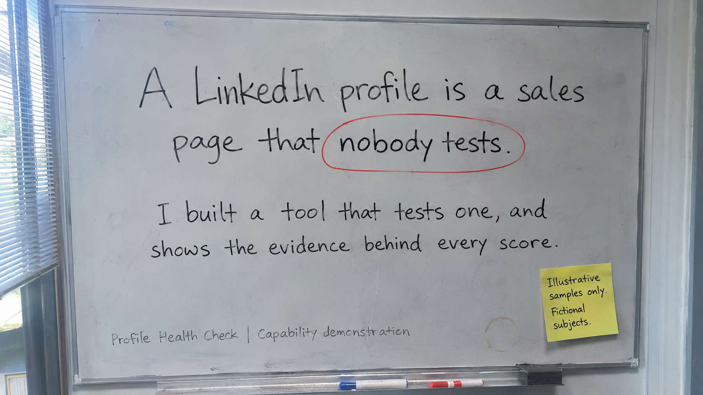
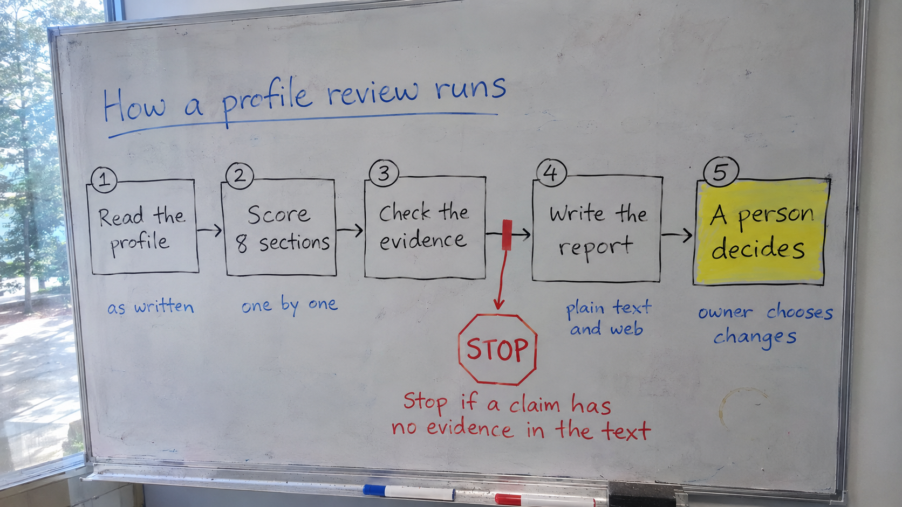
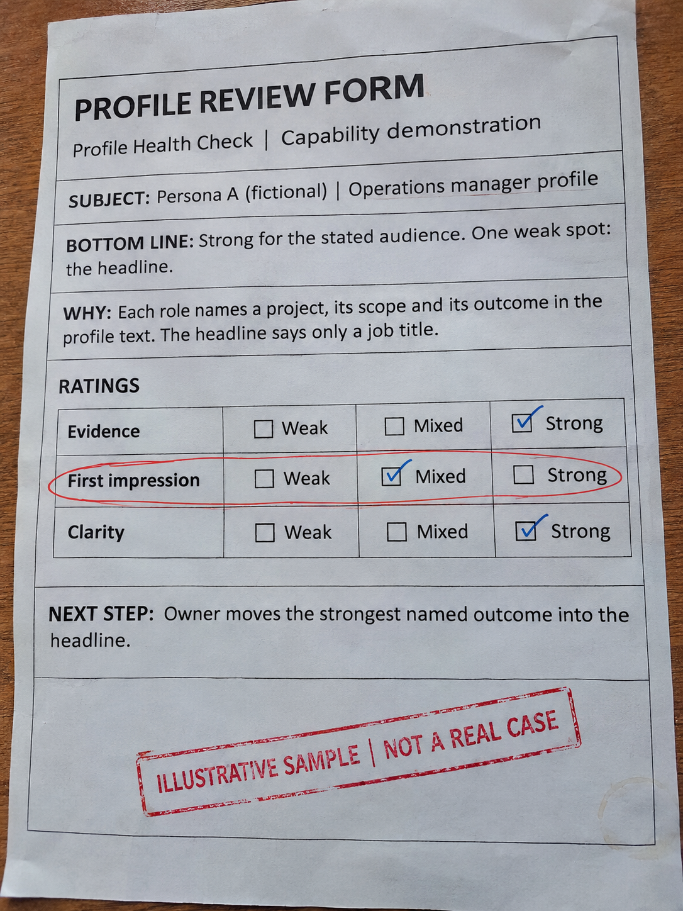
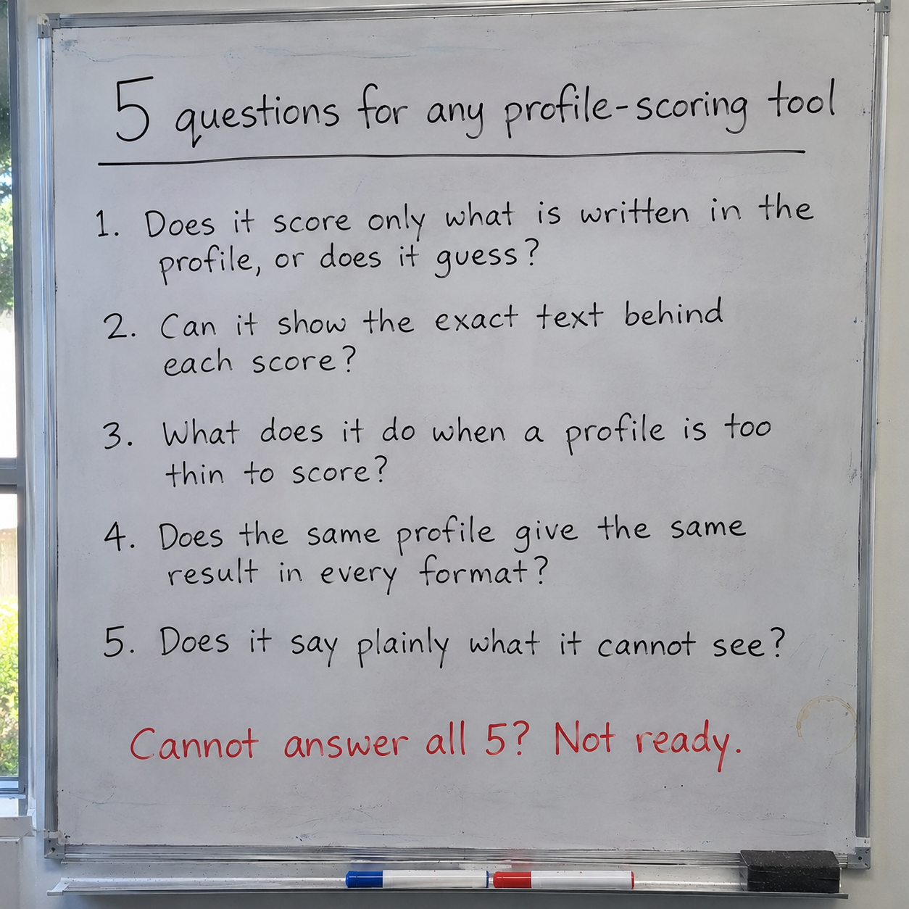

# A LinkedIn profile is a sales page that nobody tests.

I built a tool that tests one, and shows the evidence behind every score.

Try the live demo: https://business-ai-practitioner.github.io/business-solutions-showcase/409-linkedin-profile-health-check/

Below: 3 worked examples on fictional profiles, 5 design decisions, and 5 questions that test any profile-scoring tool.

*Profile Health Check | Capability demonstration, not a production system.*

## The problem

A stranger opens a profile. They decide whether to reply, shortlist or move on.

The profile owner rarely sees that decision. They see silence.

Feedback often arrives as opinion: "tighten the headline", "add more detail". Two reviewers give two different answers, and neither can show their evidence.

For a business, the same gap sits behind the public profiles of its leaders, sales teams and recruiters.

## What I built

A tool that reviews a LinkedIn profile as a market-facing signal, not as a CV.

A CV is read by someone who is already hiring. A profile is read by strangers who have not yet decided to act.

The tool scores 8 sections, one by one. It gives the result in two forms: a plain-text report and a styled web report. A separate demo screen was built for screen-share presentations.

1. **Read.** The profile is taken in as it is written.
2. **Score.** Each of the 8 sections is scored on its own.
3. **Check evidence.** A claim the profile does not support earns no credit. Any inference is labelled as one.
4. **Report.** One result, shown two ways: plain text and styled web.
5. **A person decides.** The owner chooses what to change.

The tool does not invent facts about the person. If the text does not show it, the report does not say it.

## 3 worked examples

**Illustrative samples.** I constructed these to show the layout and the types of outcome. They are not records of real cases, and every persona is fictional. The sample uses plain-word ratings. The real section names and rules are not published.

**Example 1: claims backed by evidence**
> **Persona A (fictional) | Operations manager profile**
> **Bottom line:** Strong for the stated audience. One weak spot: the headline.
> **Why:** Each role names a project, its scope and its outcome in the profile text. The headline says only a job title.
> **Ratings:** Evidence strong. First impression mixed. Clarity strong.
> **Next step:** Owner moves the strongest named outcome into the headline.

**Example 2: adjectives, no proof**
> **Persona B (fictional) | Sales leader profile**
> **Bottom line:** Little credit given. The claims are not supported by the text.
> **Why:** The profile says "results-driven" and "passionate". It names no result, project or scope. Adjectives describe the writer, not the work.
> **Ratings:** Evidence weak. First impression mixed. Clarity mixed.
> **Next step:** Owner adds 1 named outcome per role, or removes the claim.

**Example 3: too thin to score**
> **Persona C (fictional) | Early-stage profile**
> **Bottom line:** Not enough to score fairly.
> **Why:** The profile gives a name, a job title and a company. Many sections have nothing to read, so the report says what is missing instead of guessing.
> **Ratings:** Evidence not rated. First impression not rated. Clarity not rated.
> **Next step:** Owner adds role detail, then the review is run again.

## What stops each risk

| What could go wrong | The control | Where |
|---|---|---|
| Praise the profile has not earned | Scores rest on evidence in the profile text only | Step 3 |
| Invented achievements in the report | A hard ban on invented facts, with inferences labelled | Step 3 |
| A strong section hides a weak one | Each of the 8 sections is scored on its own | Step 2 |
| Two report formats tell different stories | The result is produced once, then shown two ways | Step 4 |
| A real person exposed on a shared screen | Demos use fictional personas only | Demo screen |

## Decisions I made and rejected

| Decision | Why |
|---|---|
| Treat a profile as a market signal, not a CV | Strangers read it, and they have not decided to act. |
| Score evidence only | A claim the profile cannot support earns no credit. |
| Score once, present twice | Presentation never changes a score. |
| Score 8 sections one by one | A strong section cannot hide a weak one. |
| Fictional personas in demos | A real person is never shown on a screen. |

## Proof beats adjectives

A profile is not what you did. It is what a stranger can see you did.

Words such as "passionate" and "results-driven" describe the writer. A named project, a scope and an outcome describe the work.

The tool gives credit to the second kind.

## 5 questions for any tool

1. Does it score only what is written in the profile, or does it guess?
2. Can it show the exact text behind each score?
3. What does it do when a profile is too thin to score?
4. Does the same profile give the same result in every format?
5. Does it say plainly what it cannot see?

A tool that cannot answer these is giving opinions with numbers attached.

## Limits

- Fictional samples only. No results on real profiles are shown or claimed.
- No accuracy, adoption or hiring-outcome figures are claimed. A good report does not guarantee replies or offers.
- It reads what a profile says. It cannot see views, messages or who read the profile.
- The section names and rules are proprietary. This page shows behaviour, not method, so the scoring cannot be checked from here.
- Not formal model validation or independent assurance of an AI system.

## Work with me

The tool is proprietary and built for individuals, so it is not offered from this page. What I offer is the method behind it. This page is for heads of people, talent, learning and innovation in banks, fintechs and other corporates, and for career, recruitment and training firms.

- **Tool build:** a scored review tool for your own use case, built on your criteria with the same evidence-only approach.
- **Method workshop:** a session that teaches your team to turn their expertise into a repeatable, evidence-based review tool.
- **Design review:** a review of how an AI-assisted scoring tool is built, and what it must not claim, before it is used on staff or customers.

**Enquiries:** send me a message on LinkedIn. Say which offer interests you and what decision you are trying to make safer.

Name: Ketul Shah. LinkedIn: https://www.linkedin.com/in/ketulhshah/
