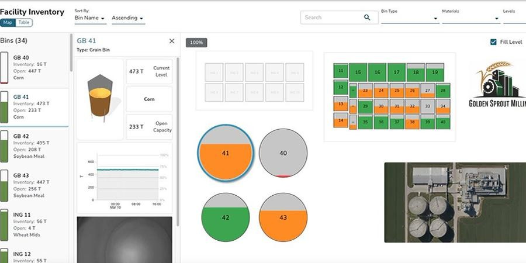

# PR001 – AI-Assisted Grain Inventory Process Analysis

## Project overview

This project explored how AI-assisted business analysis can help understand a complex grain inventory and valuation process, identify process complexity and highlight opportunities for simplification.

The work involved reviewing existing Excel-based working files, understanding relationships between information and calculations, and exploring how a more centralised approach could support the process.

The project was undertaken collaboratively, bringing together business process knowledge, analysis and practical problem-solving.

## The business challenge

Inventory management and valuation processes can become difficult to maintain when information is spread across multiple spreadsheets, worksheets and interconnected calculations.

This can make it harder to:

- Understand how information flows through the process.
- Identify dependencies between different working files.
- Review how operational information supports reporting and valuation.
- Maintain consistency across related spreadsheets.
- Identify opportunities to simplify the overall process.

The project focused on understanding these challenges rather than assuming that technology alone would solve them.

## What we explored

The work covered three connected areas:

*1. Existing process and workbook analysis*

- Reviewed the structure of existing Excel-based working files.
- Explored how information was organised across worksheets.
- Examined the broader process and relationships between information.

*2. Process analysis and simplification*

- Considered how the existing process could be made easier to understand and maintain.
- Explored opportunities to reduce fragmentation.
- Considered a more centralised approach to organising inventory information.

*3. Analysis dashboard*

- Reviewed a separate analysis dashboard.
- Considered how information could be presented to support business understanding and review.
- Explored the relationship between operational information and management-level analysis.

### Dashboard examples

**Dashboard 1 – P&L Overview**

**Dashboard 2 – Inventory Overview**

## Exploring a centralised Excel approach

A centralised Excel model was developed as an exploratory approach to the problem.

The model has been handed over to the business process owner for further development and validation.

It should therefore be understood as work in progress, not as a completed or production-ready solution.

## Where AI added value

AI was used as an analytical aid to support the exploration of a complex business process.

The project illustrates how AI can assist with:

- Structuring a complex problem.
- Exploring relationships between information and process steps.
- Supporting analysis and identifying areas for further investigation.
- Helping translate a business problem into a more structured solution concept.

AI supported the work; business understanding and human review remained important throughout.

## Project status

*Status: Exploratory analysis completed and validation ongoing.*

The centralised model has been handed to the business process owner. Further development and validation are expected to take place over the coming weeks.

No claim is made that the model has been fully implemented, independently validated or deployed.

## Key learning

This project reinforced an important principle:

*Before automating a business process, understand the process itself.*

AI can help accelerate analysis and structure thinking, but it does not replace business knowledge, process-owner input or validation.

## Project contributors

This was a collaborative exercise. Each participant brought knowledge and contributions from their respective areas, which helped shape the overall analysis and solution exploration.

Mansi Tayal, https://www.linkedin.com/in/mansitayal/
Navpreet Singh, https://www.linkedin.com/in/navpreet-singh-finance-innovation/
Ketul Shah, https://www.linkedin.com/in/ketulhshah/

---

## Data and confidentiality

This case study is presented at a high level. Public examples should use synthetic data and exclude confidential business information and proprietary operational details.
